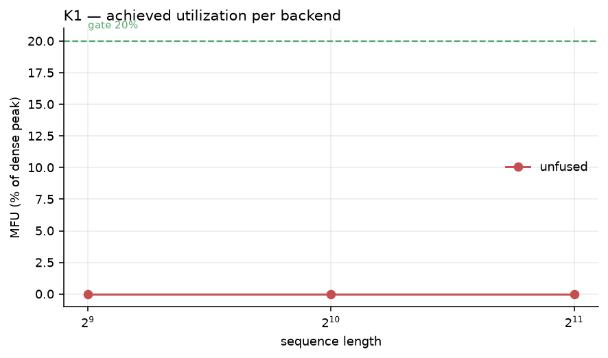
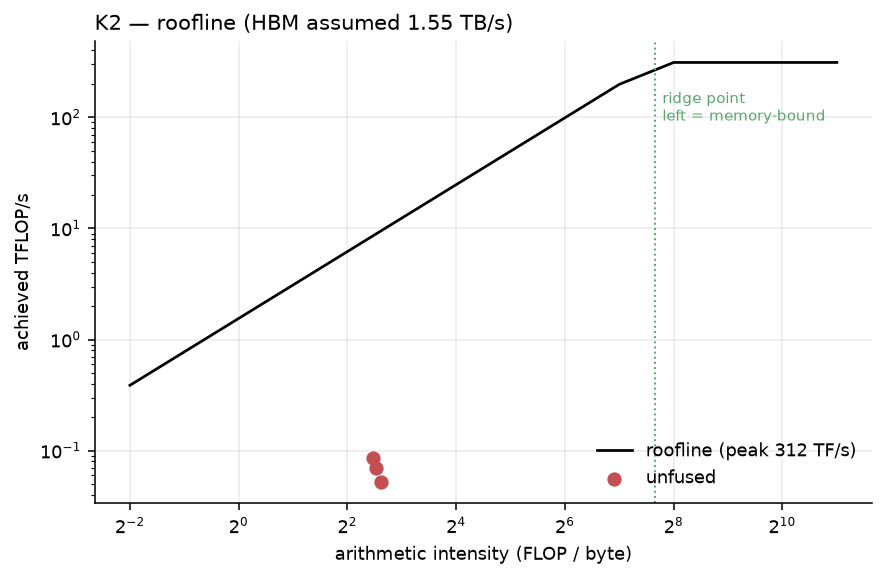
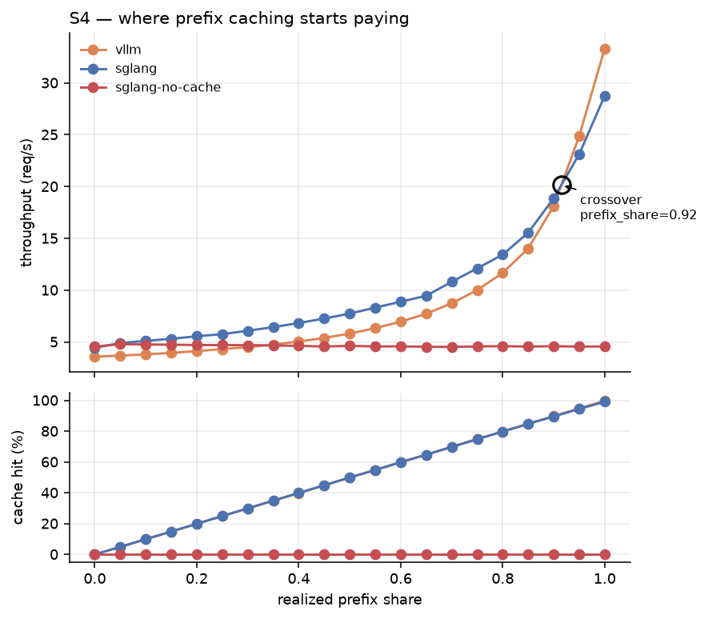
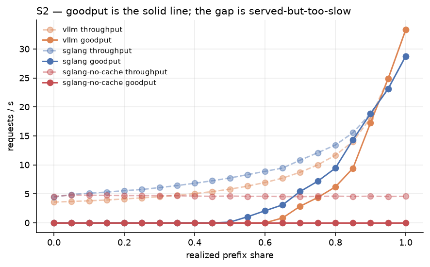
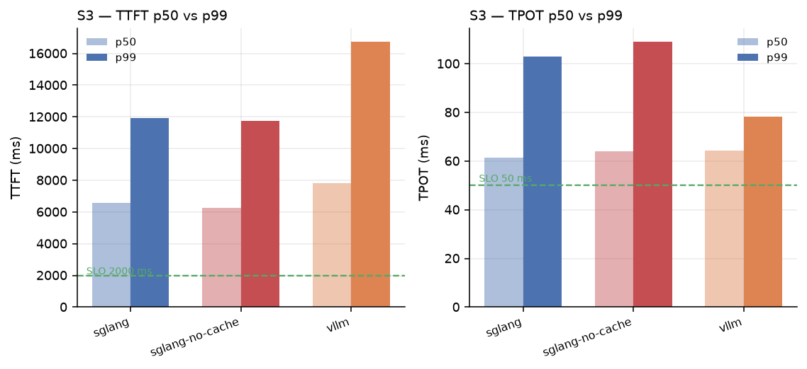

# llm-inference-stack

**Where does a prefix cache stop paying for itself, and is a hand-written
attention kernel worth shipping?** Two questions, each with a gate written down
before the measurement, answered on an A100.


**[→ Interactive demo](https://shrutibora001.github.io/llm-inference-stack/demo.html)** — drag
`P` to watch half a ring go idle under causal masking, then drag your workload's
shared-prefix fraction and see which framework wins.
**[→ Results dashboard](https://shrutibora001.github.io/llm-inference-stack/)** — both
rebuilt from `results/` on every push, so neither can disagree with the figures below.

<!-- Add once causal-attention-load-imbalance is public, so CI can install dattn:
[](https://github.com/ShrutiBora001/llm-inference-stack/actions/workflows/ci.yml)
-->

## Abstract

Serving frameworks are usually compared at one workload point, and custom
kernels are usually adopted because they were written. This project does
neither. It sweeps shared-prefix length as the independent variable across 63
runs and finds a **crossover at 0.915** where vLLM overtakes SGLang — so a
single-point benchmark picks the wrong framework about half the time. It also
builds a Triton FlashAttention-2 forward pass, measures it at **38.6% MFU**
against a pre-registered 20% gate, and then **does not ship it**, because
PyTorch's own flash kernel reaches 58.8%.

Both results are negative for the thing that was built. Both were only
reachable because the gates existed first.

---

## 1. Hypothesis

Stated before the work, in falsifiable form:

> **H1.** A fused Triton attention kernel can clear 20% MFU on A100 bf16 —
> roughly 8× the unfused tiling loop — and will therefore be worth adopting as
> the serving path.
>
> **H2.** SGLang's RadixAttention beats vLLM's scheduler on prefix-sharing
> workloads, and the advantage grows monotonically with shared-prefix length.

**H1 half-failed: the gate was cleared, the conclusion was wrong.** 38.6% MFU,
24× the unfused loop — and still not worth shipping, because `torch_flash`
reaches 58.8%. Adoption was never the gate; *beating the alternative* was.

**H2 failed at the top of the range.** The advantage is real but **not
monotonic**. It peaks and then reverses: vLLM is 16% faster at full sharing.
"Monotonic" was the assumption worth testing, and it was false.

## 2. Background

[`causal-attention-load-imbalance`](https://github.com/ShrutiBora001/causal-attention-load-imbalance)
(frozen at v0.3.0) established that under causal masking, contiguous sequence
sharding leaves roughly half a ring idle, and that **striped (zigzag)**
assignment — device `r` owns chunks `r` and `2P−1−r` of `2P` — recovers it:
**1.73× at S=131072**, 99.1% of the `2−1/P` ceiling, and 1M-token attention
where all-gather OOMs.

It also reported the limitation that defines this repo: that implementation ran
at **2.5–3.4% of A100 bf16 peak**, because its tiling loop materialises the fp32
score tile to HBM. The scheduling result was sound and hardware-independent; the
kernel underneath it was the textbook pre-FlashAttention baseline.

A 1M-token result is academic if nobody would deploy the kernel that produced
it. So: replace the kernel, then serve real models and measure what changes.

## 3. Design decisions

The "why we chose what we chose" table. Each row names the alternative that was
rejected and the evidence that settled it.

| Decision | Alternative rejected | Why |
|---|---|---|
| **Context parallelism only** — shard the sequence, replicate the weights | Tensor / pipeline / data parallelism | The bottleneck under study is long-context attention. Sharding heads or layers does not change the causal triangle that causes the imbalance. |
| **Merge partials outside the kernel** via `(out, lse)` | A ring-aware kernel carrying `(acc, m, l)` | Every FlashAttention-style kernel already returns LSE. Merging outside turns "write ring attention in Triton" into "call a flash kernel and merge" — a far smaller surface, provable on CPU before renting anything. |
| **Global positions everywhere** | Local offsets plus a correction | Under striping a device owns two disjoint position ranges, so no single offset is correct. Getting it wrong emits fluent nonsense with no crash. |
| **`torch_flash` is the default backend** | Shipping the Triton kernel we wrote | 58.8% vs 38.6% MFU, measured at matched shape. The Triton kernel is kept, tested, and reported as a null result. |
| **Sweep prefix share; fix everything else** | One benchmark point, as published comparisons use | The crossover at 0.915 is invisible at any single point, and it reverses the conclusion. |
| **Greedy decoding, `ignore_eos`, fixed output length** | Realistic sampling | Temperature does not change attention's work, but it moves when EOS fires, which moves decode-step count and therefore throughput — noise unrelated to the system under test. |
| **Extend vLLM's own samplers** | A bespoke request generator | Buys comparability with published vLLM numbers and redistributes no dataset. |
| **NVSHMEM restricted to decode** | Using it on the prefill path | Communication is 1.1% of prefill runtime and stays hidden by overlap even after a hypothetical 15× kernel speedup. It cannot win there. A contract test fails if it appears. |
| **JAX excluded** | A second JAX stack | vLLM and SGLang are both PyTorch. See [future_scope.md](future_scope.md). |

### The anti-decoration contract

The organising constraint: **no technology is here for its name.** Each must do
something the others cannot, and each has a test that fails if it has become
decorative. GPU-gated checks **skip visibly** — a green laptop run is never
mistaken for a validated stack.

| Technology | Uniquely best at | Test that fails if decorative |
|---|---|---|
| **Triton** | Fast kernel authoring, autotuning | MFU ≥ 20% gate; autotuner picks a non-default config; no silent fallback |
| **NCCL** | Mature bulk collectives | Wire bytes match the closed-form model; busbw ≥ 60% of nameplate |
| **torch.compile / CUDA graphs** | Removing launch overhead | Zero graph breaks; decode launches halve under capture |
| **vLLM** | PagedAttention, continuous batching | Block table non-trivial; requests overlap in time |
| **SGLang** | RadixAttention prefix caching | Hit rate > 50% on a prefix-sharing workload |
| **raw CUDA** | Persistent kernels, device-side scheduling | One launch per ring traversal, not `P` |
| **NVSHMEM** | Device-initiated, latency-bound transfers | Must beat NCCL *in decode*; refuses to enable for prefill |
| **CUTLASS** | Peak GEMM, warp specialization | Comparison measured, not asserted; tensor cores actually used |

```bash
make contract
```

## 4. System design

```
                    ┌─────────────────────────────────────────┐
  request  ───────► │  serving/  vLLM · SGLang bindings       │
                    │            paged KV ↔ Chunk mapping     │
                    └──────────────────┬──────────────────────┘
                                       │ KVProvider + process group
                                       │   (the only framework seam)
                    ┌──────────────────▼──────────────────────┐
                    │  cp/ring.py   zigzag context-parallel   │
                    │               ring, P−1 hops, overlap   │
                    └──────────────────┬──────────────────────┘
                                       │ one (q_chunk, k_chunk) pair at a time
                    ┌──────────────────▼──────────────────────┐
                    │  kernels/  torch_flash | triton | unfused│
                    │            every backend → (out, lse)   │
                    └──────────────────┬──────────────────────┘
                                       │ partials
                    ┌──────────────────▼──────────────────────┐
                    │  lse.py    merge(out_a,lse_a, out_b,…)  │
                    └─────────────────────────────────────────┘
```

Three properties make this work:

**One interface, several backends.** Everything returns `PartialAttention(out,
lse)`, so the ring, the paging and the serving bindings were written and
CI-tested on a laptop against the `unfused` oracle, then ran on a fused kernel
unchanged.

**The merge is exact, not approximate.** Two partials combine with

```
lse_ab = logaddexp(lse_a, lse_b)
out_ab = out_a·exp(lse_a − lse_ab) + out_b·exp(lse_b − lse_ab)
```

and online softmax is order-invariant, so blocks fold in as they arrive off the
wire — in rank order, not sequence order. The ring never enters the kernel.

**The framework seam is one protocol.** A binding supplies KV storage and a
process group. Nothing else. Anything wider gives each binding somewhere for
bugs to hide.

**The trust root is outside this codebase.** `unfused` is pinned against
PyTorch's own SDPA; every other backend diffs against `unfused`. Never against
each other.

## 5. Experimental setup

| | Phase 1 (kernel) | Phase 2 (serving) |
|---|---|---|
| GPU | 1 × A100-SXM4-40GB, sm_80, 1410 MHz, 350 W | 1 × A100-SXM4-40GB |
| Driver | 595.71.05 | 590.48.01 |
| Stack | torch 2.13.0+cu130, CUDA 13.0, Triton 3.7.1 | SGLang 0.5.9 (torch 2.9.1+cu128) · vLLM 0.27.1 (torch 2.13.0+cu130) |
| Model | — (kernel microbenchmark) | Qwen2.5-1.5B |
| Shapes | H=32, Dh=128, causal, bf16, S ∈ 2048…32768 | 8192-token context, 128 output tokens |
| Load | — | 64 concurrent; saturated (qps→∞) and rate-limited (qps=4) |
| Independent variable | sequence length × backend | **prefix share, 21 points from 0.0 to 1.0** |
| Fixed | — | temperature 0, `ignore_eos`, seeded, fixed output length |
| SLO (pre-registered) | MFU ≥ 20% | TTFT p99 ≤ 2000 ms · TPOT p99 ≤ 50 ms |

Raw environment capture: [`results/environment.txt`](results/environment.txt),
[`results/environment_phase2.txt`](results/environment_phase2.txt).

## 6. Results

Every number below regenerates via `make report` from the committed files in
[`results/`](results/). CI rebuilds them on every push, so a hand-edited number
fails the build.

### 6.1 Kernel — H1



MFU (% of A100 bf16 dense peak, 312 TFLOP/s), H=32, Dh=128, causal:

| S | `unfused` | `triton` | `torch_flash` |
|---:|---:|---:|---:|
| 2,048 | 1.53% | 23.6% | 30.6% |
| 4,096 | 1.52% | 31.8% | 40.7% |
| 8,192 | 1.52% | 36.4% | 46.8% |
| 16,384 | — | **38.6%** | **51.3%** |
| 32,768 | — | 39.2% | **60.4%** |

| Validation step | Result |
|---|---|
| Compiles at the smallest shape | pass |
| Correct vs the `unfused` oracle | pass — max abs error **8.5e-3** (bf16) |
| LSE merge contract | pass |
| Autotuner explored the space | pass — chose config indices **1, 6, 7**, never 0 |
| MFU gate (20%, pre-registered) | pass — **38.6%** |
| **vs `unfused` at matched shape** | **24×** (1.52% → 36.4%) |
| **vs `torch_flash`** | **0.66×** — the reason it did not ship |

Full record: [`results/triton_validation.json`](results/triton_validation.json),
write-up in [`docs/PHASE1.md`](docs/PHASE1.md).



The roofline explains *why* the unfused loop sits at 1.5%: materialising the
score tile puts it on the bandwidth slope, far left of the ridge point. Fusing
moves it right. This is the difference between reporting 3% and accounting for
it.

### 6.2 Serving — H2



Output throughput (tok/s), saturated, 64 concurrent:

| prefix share | vLLM | SGLang | winner |
|---:|---:|---:|---|
| 0.00 | 458 | **568** | SGLang +24% |
| 0.25 | 552 | **737** | SGLang +33% |
| 0.50 | 744 | **991** | SGLang +33% |
| 0.75 | 1,280 | **1,549** | SGLang +21% |
| 0.90 | 2,319 | **2,415** | SGLang +4% |
| **0.915** | — | — | **crossover** |
| 0.95 | **3,182** | 2,959 | vLLM +8% |
| 1.00 | **4,265** | 3,683 | vLLM +16% |

The advantage is real and large at low sharing, and it **reverses**. Choosing a
framework from one benchmark point is a coin flip.



Goodput — requests meeting *both* SLOs — is the headline serving metric, and it
behaves nothing like throughput:

| | SGLang | vLLM |
|---|---|---|
| SLO attainment across the sweep | 0% → 100% | 0% → 100% |
| Peak goodput | 28.8 req/s | **33.3 req/s** |
| TTFT p99 range | 265 – 11,901 ms | 712 – 16,738 ms |

At low prefix share, throughput is healthy and **goodput is zero**: TTFT p99
reaches 16.7 s against a 2 s SLO. A system can post excellent throughput while
failing every request's latency target. Rate-limited at qps=4, attainment
recovers to 11–100% ([`results/serving.jsonl`](results/serving.jsonl)).



### 6.3 Ablation — is it really RadixAttention?

The third configuration, `sglang-no-cache`, is the control. Same engine, same
workload, prefix caching disabled:

| prefix share | cache on | cache off | speedup |
|---:|---:|---:|---:|
| 0.00 | 568 | 585 | 0.97× |
| 0.50 | 991 | 592 | 1.67× |
| 0.90 | 2,415 | 588 | 4.11× |
| 1.00 | 3,683 | 585 | **6.30×** |

Cache-off is **flat at ~585 tok/s** across the entire sweep. The entire curve is
attributable to the radix tree, not to scheduling, batching or the workload
generator. Without this column the headline result would be a correlation.

## 7. Limitations

Stated here rather than discovered by a reader:

- **The serving study ran on one GPU.** Context parallelism is implemented,
  unit-tested and verified across gloo ranks on a laptop, but the Phase 2
  numbers do not exercise it. They measure framework scheduling and prefix
  caching, not CP.
- **SGLang and vLLM ran under different torch builds** (2.9.1+cu128 vs
  2.13.0+cu130) because the disk could not hold both. A fraction of the
  cross-framework gap may be attributable to the stack, not the scheduler. The
  SGLang-vs-no-cache ablation is unaffected — same binary, same session.
- **Synthetic prompts, not a real trace.** Prefix share is controlled exactly,
  which is the point; a ShareGPT anchor would tie the curve to published
  baselines and has not been run.
- **One model, one context length.** 1.5B at 8K. Ratios should transfer while
  attention dominates runtime; absolute numbers will not.
- **No backward pass.** Inference-shaped throughout.
- **Phase 3 is scaffolded, not built** — persistent CUDA ring, NVSHMEM decode
  path, CUTLASS comparison. Contract tests for all three exist and skip.

## 8. Reproduce

Everything except the GPU measurements runs on a laptop with no GPU.

```bash
make venv && make test && make contract   # 178 tests; GPU checks skip with reasons
make report                               # rebuild every figure from results/
```

The check that matters: delete `report/figures/`, run `make report`, confirm
every figure returns. If a number was ever typed rather than measured, that is
where it surfaces. CI does exactly this on every push.

```bash
deploy/remote.sh <PORT> <HOST> all        # rented box: sync, preflight, run, pull results
docker build -f deploy/Dockerfile -t lis:latest . && \
  docker run --gpus all --rm -v "$PWD/results:/workspace/lis/results" lis:latest all
```

No credentials reach the box — code goes up by `rsync` over the key the provider
already has. Every path runs preflight first, because a wrong interconnect
silently invalidates every timing after it. Runbook, verbs and cost discipline:
[deploy/README.md](deploy/README.md).

## Layout

```
src/lis/
  kernels/      dispatcher + unfused oracle, torch_flash, Triton; Phase 3 stubs
  lse.py        LSE merging — the kernel contract
  rope.py       RoPE with global positions; the striping trap
  cp/           framework-agnostic context-parallel ring + KV provider seam
  serving/      paged-KV mapping, vLLM and SGLang bindings
  metrics.py    every metric defined once, with its gate
  workload.py   prefix-share sweep over vLLM's own samplers
  jit.py        torch.compile + CUDA graph capture, decode-scoped
bench/          kernel.py (MFU/roofline) · serving.py (goodput) · comm
report/         make_figures.py · make_dashboard.py — no number hardcoded
results/        the committed evidence; every figure regenerates from it
deploy/         Dockerfile + one-command remote runner
docs/           PHASE1 · PHASE2 · PIPELINE · FOUNDATIONS · runbooks · READING
```

178 tests · `src/` ≈ 3k lines · MIT.

| Phase | State |
|---|---|
| Correctness: RoPE, LSE merge, CP ring, paging | done — laptop-only |
| **Phase 1** — fused kernel validated and chosen | **done** |
| **Phase 2** — prefix-share crossover, SGLang vs vLLM | **done**, 63 runs |
| Phase 3 — persistent CUDA ring, NVSHMEM (decode), CUTLASS | scaffolded, contract-gated |
